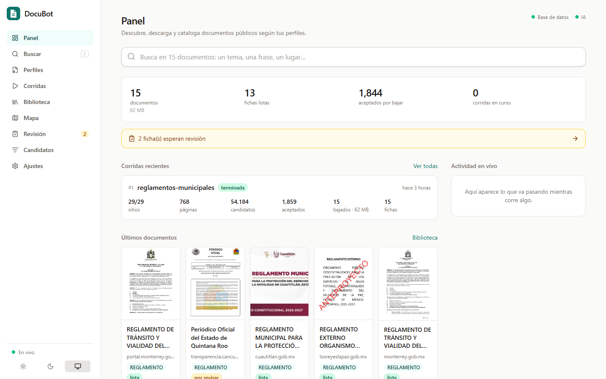
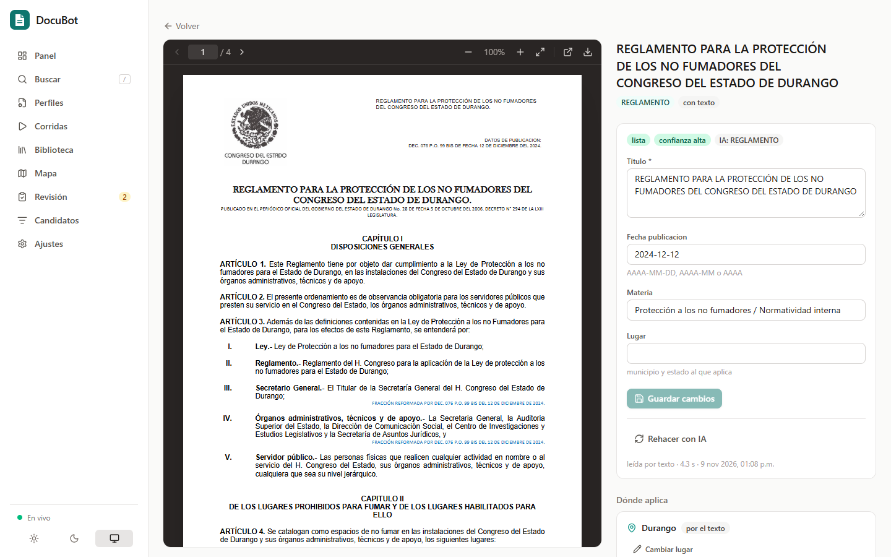
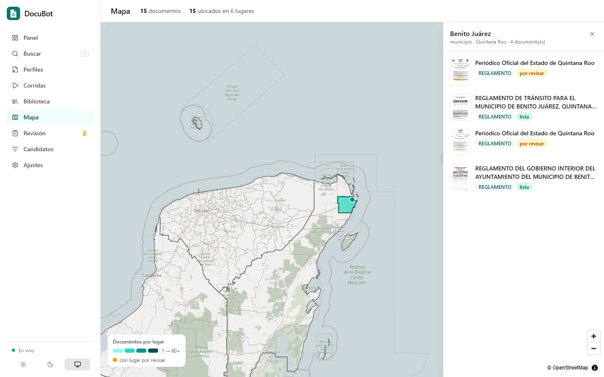
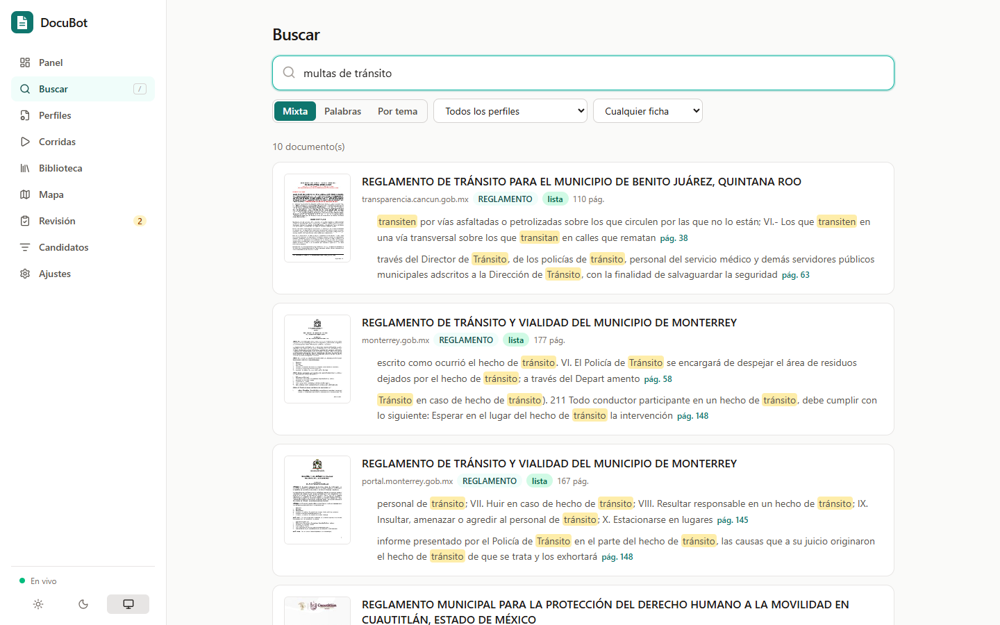

# DocuBot

**Descubre, descarga y cataloga documentos públicos de la web, según lo que tú definas.**

Le dices qué buscar (en qué sitios, con qué consultas, qué cuenta como
documento y qué datos sacar de cada uno) y DocuBot:

1. busca los sitios y documentos;
2. descarga lo que vale la pena;
3. lee cada documento y llena su ficha con IA, local o remota;
4. lo ubica en un mapa;
5. deja todo listo para buscar por palabras o por tema.

Todo desde una interfaz web que muestra el avance en vivo.

El motor no sabe nada del tema. Cada colección es un **perfil** en YAML, así
que el mismo DocuBot sirve para planes municipales, normas oficiales,
reglamentos, presupuestos o cualquier documento publicado en la web.



<table>
  <tr>
    <td></td>
    <td></td>
  </tr>
  <tr>
    <td align="center">Visor del documento junto a su ficha</td>
    <td align="center">Documentos por lugar</td>
  </tr>
  <tr>
    <td colspan="2"></td>
  </tr>
  <tr>
    <td colspan="2" align="center">Búsqueda por palabras y por tema, con pasajes que abren el PDF en su página</td>
  </tr>
</table>

## Qué hace

- **Descubre** con buscadores (SearXNG gratis, Brave, Serper, SerpAPI),
  listas de dominios, Common Crawl, el Internet Archive y la exploración de
  cada sitio (sitemaps, enlaces, visores de Drive y Dropbox). Respeta
  robots.txt y un ritmo por dominio.
- **Califica** cada documento encontrado según los tipos del perfil, y
  **descarga** los que pasan el corte, sin duplicados (cada archivo se guarda
  por su huella). Si un documento ya no está en línea, prueba la copia del
  Internet Archive.
- **Lee** cada documento, también los escaneados, y una **IA llena su ficha**
  con los campos del perfil. Puede ser Ollama local, OpenAI, Anthropic,
  cualquier servidor compatible o tu propio proveedor. Valida cada campo y
  manda a revisión lo dudoso.
- **Ubica** cada documento en un catálogo de lugares, por clave y no por
  nombre (los nombres se repiten), y lo muestra en un mapa. Incluye el
  catálogo de México: 32 estados y 2,475 municipios de INEGI.
- **Busca** por palabras (español, sin acentos, por raíz) o por tema, con un
  modelo chico que corre en CPU, sin GPU ni llaves.
- **Se reanuda solo:** cada etapa es una cola en Postgres, así que una corrida
  interrumpida sigue donde quedó.

## Empezar

Necesitas Docker con Docker Compose v2.24 o más reciente.

```bash
git clone https://github.com/seyler-librado/DocuBot.git docubot && cd docubot
cp .env.example .env              # cambia la contraseña de Postgres
docker compose up -d --build
```

Abre <http://127.0.0.1:8080>. Viene un perfil de ejemplo en
`config/perfiles/ejemplo.yaml`, y hay más listos en [`ejemplos/`](ejemplos):
planes municipales de México, normas oficiales mexicanas y ordenanzas de
España.

```bash
cp -r ejemplos/planeacion-municipal-mx config/perfiles/
docker compose --profile searxng up -d        # buscador propio, gratis (opcional)
```

Para las fichas con IA, configura un proveedor en `.env`
([cómo](docs/ia.md#proveedores)). Sin IA, todo lo demás funciona.

## Documentación

| guía | contenido |
|---|---|
| [Perfiles](docs/perfiles.md) | referencia completa del YAML |
| [Descubrimiento y descarga](docs/descubrimiento.md) | corridas, fuentes, buscadores, exploración, calificación, descarga |
| [Texto, fichas e IA](docs/ia.md) | proveedores, validación de fichas, proveedores propios, cómo medir a la IA |
| [Geografía y mapa](docs/geografia.md) | catálogos de lugares y cómo se ubica cada documento |
| [Búsqueda](docs/busqueda.md) | por palabras, por tema y mixta |
| [Configuración](docs/configuracion.md) | `config/docubot.yaml`, `.env` y servicios de Docker |
| [Comandos y API](docs/cli.md) | `docubot …` desde la terminal y la API REST |
| [Arquitectura](docs/arquitectura.md) | servicios, pipeline, datos y decisiones |
| [Preguntas frecuentes](docs/preguntas.md) | requisitos, redes que bloquean descargas, respaldos, legalidad |

## Desarrollo

```bash
docker compose --profile pruebas run --rm --build pruebas   # pruebas (con su propia base)
cd frontend && npm install && npm run dev                   # interfaz con recarga en vivo
```

Ver [CONTRIBUTING.md](CONTRIBUTING.md).

## Buenos modales

DocuBot se identifica con su propio user agent: en `red.user_agent` pon una
URL o un correo donde puedan contactarte. Respeta robots.txt y limita las
peticiones por dominio (1 por segundo por omisión). Muchos sitios públicos
corren en servidores modestos: no subas esos límites sin necesidad.

## Licencia

[MIT](LICENSE).

El catálogo de lugares de México se deriva del Marco Geoestadístico de INEGI
(datos abiertos). El mapa base es de OpenStreetMap.
